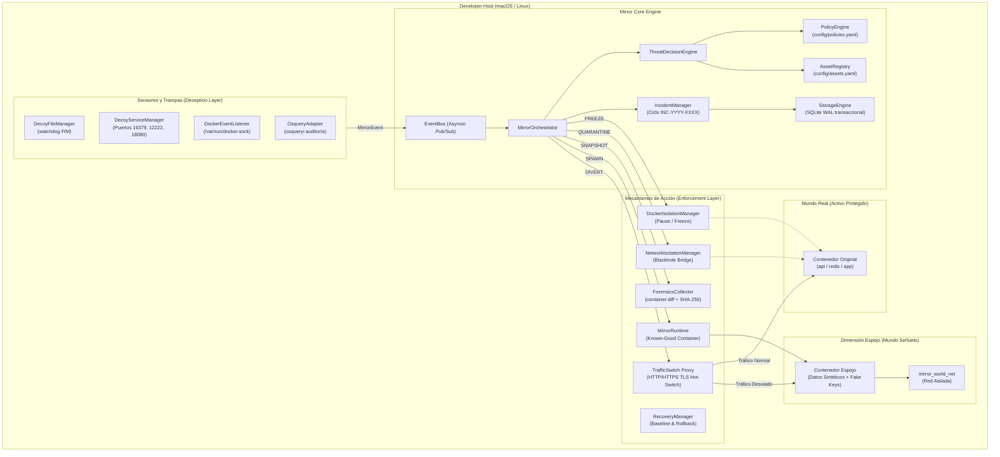
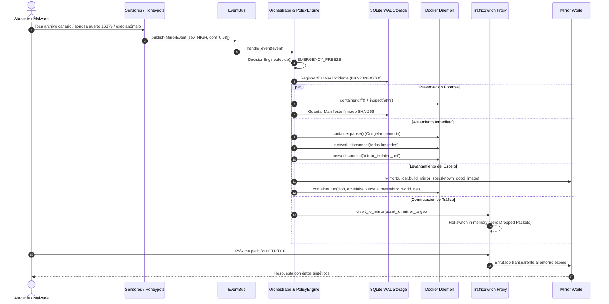

# 🏛️ Dimensión Espejo: Arquitectura Técnica Integral

> **Documento de especificación técnica interna y arquitectura del sistema.**  
> Dimensión Espejo es un framework de defensa activa, decepción y conmutación a entornos espejo (*honeynets dinámicas*) diseñado para proteger activos de desarrollo y producción local contra intrusiones, movimientos laterales y exfiltración de credenciales.

---

## 📑 Tabla de Contenidos
1. [Visión y Principios de Diseño](#1-visión-y-principios-de-diseño)
2. [Diagrama de Arquitectura Global](#2-diagrama-de-arquitectura-global)
3. [Sub-Sistemas del Core](#3-sub-sistemas-del-core)
4. [Flujo de Vida de un Evento e Incidente (Diagrama de Secuencia)](#4-flujo-de-vida-de-un-evento-e-incidente-diagrama-de-secuencia)
5. [Modelo de Amenazas y Mapeo MITRE ATT&CK](#5-modelo-de-amenazas-y-mapeo-mitre-attck)
6. [Manejo de Concurrencia y Almacenamiento Transaccional](#6-manejo-de-concurrencia-y-almacenamiento-transaccional)

---

## 1. Visión y Principios de Diseño

El paradigma tradicional de seguridad en desarrollo se divide en:
* **Alertas pasivas (SIEM/IDS)**: Notifican cuando el daño ya está hecho o cuando las credenciales ya fueron exfiltradas.
* **Bloqueos destructivos**: Matan contenedores o procesos, destruyendo la memoria volátil antes de que se pueda recopilar evidencia forense.

**Dimensión Espejo** rompe este paradigma mediante cuatro pilares:
1. **Decepción preventiva con casi cero falso positivo**: Los señuelos (*canaries* y puertos trampa) son recursos que ningún desarrollador legítimo debería tocar. La interacción implica una intención hostil con alta certeza.
2. **Desacople Amenaza-Acción**: La severidad del evento y la criticidad del activo pasan por un motor de políticas declarativo (`PolicyEngine`) antes de accionar.
3. **Preservación Forense antes de Aislamiento**: Al congelar el proceso (`container.pause()`) en lugar de matarlo (`kill`), se preserva la memoria y el sistema de archivos modificado.
4. **Continuidad Operativa mediante el Espejo**: Se desvía el atacante en caliente a un clon con datos sintéticos y secretos falsificados mediante un Reverse Proxy dinámico.

---

## 2. Diagrama de Arquitectura Global

---

## 3. Sub-Sistemas del Core

| Módulo | Archivo Principal | Responsabilidad |
| :--- | :--- | :--- |
| **EventBus** | [`core/bus.py`](file:///Users/fabiodanielsegura/DIMENCION-ESPEJO/core/bus.py) | Bus asíncrono de eventos tipados basado en publicadores/suscriptores con soporte de wildcard (`*`) e historial. |
| **AssetRegistry** | [`core/assets.py`](file:///Users/fabiodanielsegura/DIMENCION-ESPEJO/core/assets.py) | Mapeo declarativo de activos, niveles de criticidad (`CRITICAL`, `HIGH`, `MEDIUM`, `LOW`) y perfiles de contención. |
| **PolicyEngine** | [`core/policies.py`](file:///Users/fabiodanielsegura/DIMENCION-ESPEJO/core/policies.py) | Evaluación de matrices de mitigación según severidad de la alerta vs. criticidad del activo (`ALLOW`, `MONITOR`, `DECOY`, `ISOLATE`, `QUARANTINE`, `EMERGENCY_FREEZE`). |
| **DecisionEngine** | [`core/decision.py`](file:///Users/fabiodanielsegura/DIMENCION-ESPEJO/core/decision.py) | Correlación entre telemetría del sensor, reglas de política y confianza probabilística. |
| **IncidentManager** | [`core/incidents.py`](file:///Users/fabiodanielsegura/DIMENCION-ESPEJO/core/incidents.py) | Ciclo de vida y escalado de incidentes (`OPEN`, `CONTAINED`, `INVESTIGATING`, `RESOLVED`) con numeración correlativa persistente. |
| **StorageEngine** | [`core/storage.py`](file:///Users/fabiodanielsegura/DIMENCION-ESPEJO/core/storage.py) | Persistencia ACID multihilo en SQLite con WAL activado para tolerancia a caídas e integridad de eventos. |
| **Orchestrator** | [`core/orchestrator.py`](file:///Users/fabiodanielsegura/DIMENCION-ESPEJO/core/orchestrator.py) | Despachador de acciones concurrentes: congelamiento, aislamiento de red, recolección forense, instanciación del espejo y conmutación de tráfico. |

---

## 4. Flujo de Vida de un Evento e Incidente (Diagrama de Secuencia)

El siguiente diagrama detalla la interacción paso a paso cuando un atacante interactúa con un señuelo o genera una anomalía de proceso:

---

## 5. Modelo de Amenazas y Mapeo MITRE ATT&CK

Dimensión Espejo implementa controles y detecciones alineados a la matriz de **MITRE ATT&CK**:

| Táctica MITRE | Técnica | Implementación en Dimensión Espejo | Mecanismo |
| :--- | :--- | :--- | :--- |
| **Discovery** | `T1046` (Network Service Discovery) | Puertos trampa en `deception/decoy_services.py` | Sockets falsos de Redis (16379), SSH (12222), HTTP (18080). |
| **Credential Access** | `T1552.001` (Credentials in Files) | Archivos canario en `deception/decoy_files.py` | FIM con watchdog en `.env.backup`, `.aws/credentials`, `fake_tokens.json`. |
| **Execution** | `T1059` (Command and Scripting Interpreter) | Sensor `adapters/docker/listener.py` y `osquery` | Detección de `exec_create` o procesos sospechosos (`nc -e`, `nmap`, reverse shells). |
| **Lateral Movement** | `T1210` (Exploitation of Remote Services) | Aislamiento en `isolation/network.py` | Expulsión forzada de redes compartidas a un puente interno blackhole. |
| **Collection / Exfiltration** | `T1560` (Archive Collected Data) | Sanitización en `mirror/sanitization.py` | Sustitución de secretos reales por credenciales sintéticas de alta entropía. |

---

## 6. Manejo de Concurrencia y Almacenamiento Transaccional

* **Event Loop Asíncrono**: Todo el pipeline de telemetría y ruteo corre sobre `asyncio` nativo de Python, permitiendo procesar cientos de eventos por segundo sin bloqueos de I/O.
* **Tolerancia a Concurrencia en SQLite**: Para evitar errores `database is locked`, [`core/storage.py`](file:///Users/fabiodanielsegura/DIMENCION-ESPEJO/core/storage.py) utiliza:
  * Modo **WAL** (`PRAGMA journal_mode=WAL`).
  * `PRAGMA synchronous=NORMAL`.
  * `PRAGMA busy_timeout=5000` (5 segundos de espera activa).
  * Conexión por hilo (`threading.local`) para máxima seguridad entre subprocesos.
* **Debouncing Forense**: Para evitar ataques de denegación de servicio por saturación de disco (I/O exhaustion) al crear snapshots, `forensics_collector.py` incluye una ventana de debouncing configurable (por defecto 2.0 segundos).
